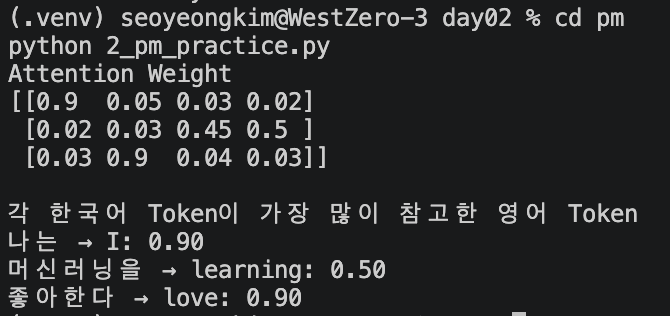

# 2일차 오후 실습 제출물
영어 문장과 번역 문장을 놓고 단어 간 Attention 관계를 직접 표시합니다.
```text
I love machine learning.
나는 머신러닝을 좋아한다.

| 한국어 \ 영어 |    I | love | machine | learning |
| -------- | ---: | ---: | ------: | -------: |
| 나는       |  0.9 | 0.05 |    0.03 |     0.02 |
| 머신러닝을    | 0.02 | 0.03 |    0.45 |     0.50 |
| 좋아한다     | 0.03 | 0.90 |    0.04 |     0.03 |
```
=> 행렬 설계 (가중치는 임의로 계산함 !! )   


