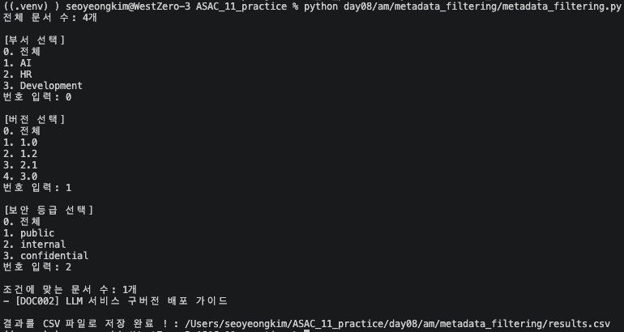

# Metadata-filtering
## 목표
```
documents.json에서 문서 목록 읽기
→ 원하는 Metadata 조건 설정
→ 조건이 모두 일치하는 문서만 선택
→ 화면에 출력
→ CSV 파일로 저장
```
> 전체 문서를 하나씩 확인하면서, 지정한 Metadata 조건을 모두 만족하는 문서만 결과에 추가!!
## documents.json
#### 1. document_id : 문서 아이디
#### 2. title : 문서 제목
#### 3. content : 문서 내용
#### 4. department : 문서 담당 부서
#### 5. document_type : 문서 타입
#### 6. version : 버전 표기
#### 7. security_level : 보안 등급 : internal OR confidential

## metadata_filtering.py
```
metadata_filtering.py 실행
        ↓
if __name__ == "__main__"
        ↓
main() 실행
        ↓
load_documents()
        ↓
documents.json 읽기
        ↓
metadata_filter 설정
        ↓
filter_documents()
        ↓
문서를 하나씩 검사
        ↓
모든 조건이 일치한 문서만 results에 저장
        ↓
화면 출력
        ↓
save_results()
        ↓
metadata_result.csv 저장
```
### 기능 추가
기존 : 메타데이터를 하드코딩으로 입력   
NEW : 메타데이터를 option으로 선택할수 있게 개선   
