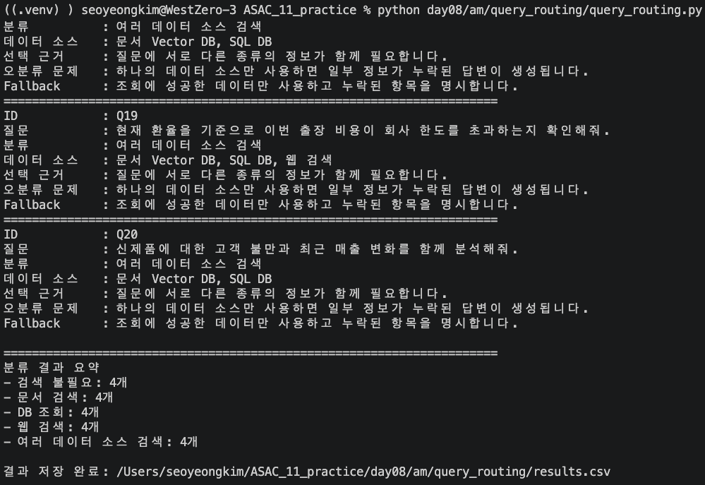

# Query_routing 실습

## 목표

```text
questions.json에서 질문 목록 읽기
→ 질문의 키워드 확인
→ 적절한 데이터 소스 선택
→ Routing 결과 출력
→ CSV 파일로 저장
```

> 질문 유형에 따라 문서 검색, DB 조회, 웹 검색 등을 자동으로 선택한다!!

## Routing 유형

#### 1. 검색 불필요

인사말, 계산, 요약처럼 외부 검색이 필요 없는 질문

#### 2. 문서 검색

규정, 절차, 가이드처럼 문서 내용이 필요한 질문
→ `문서 Vector DB`

#### 3. DB 조회

사용자 수, 매출, 재고처럼 정확한 데이터가 필요한 질문
→ `SQL DB`

#### 4. 웹 검색

뉴스, 환율, 최신 버전처럼 최근 정보가 필요한 질문
→ `Web Search`

#### 5. 여러 데이터 소스 검색

문서와 DB 등 여러 정보가 함께 필요한 질문

## questions.json

#### 1. id : 질문 아이디

#### 2. question : 사용자 질문

총 20개의 질문을 저장한다.

## query_routing.py

```text
query_routing.py 실행
        ↓
main() 실행
        ↓
load_questions()
        ↓
questions.json 읽기
        ↓
route_query()
        ↓
질문의 키워드 확인
        ↓
데이터 소스 선택
        ↓
결과 출력
        ↓
save_results()
        ↓
results.csv 저장
```

## Routing 원리

```text
"규정", "절차", "가이드"
→ 문서 Vector DB

"사용자 수", "매출", "재고"
→ SQL DB

"뉴스", "환율", "최신 버전"
→ 웹 검색
```

두 개 이상의 데이터 소스가 선택되면:

```text
여러 데이터 소스 검색
```

## results.csv
| 컬럼 | 설명 |
|---|---|
| `id` | 질문 아이디 |
| `question` | 원본 질문 |
| `route` | 최종 Routing 유형 |
| `selected_sources` | 선택된 데이터 소스 |
| `reason` | 데이터 소스 선택 근거 |
| `wrong_routing_problem` | 잘못 Routing했을 때 발생하는 문제 |
| `fallback` | 검색 실패 시 사용할 대체 데이터 소스 |

### 기능 구현
기존 : 모든 질문을 동일한 데이터 소스에서 검색
NEW : 질문의 키워드에 따라 데이터 소스를 자동 선택



