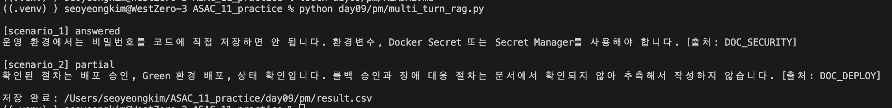

# 오후 RAG 공통 실습
## 흐름 구조 및 원칙
```
rewrite_question()
→ 대화 이력으로 독립 질문 생성

run_rag()
→ Metadata 결정
→ 문서 검색·중복 제거·신뢰도 정렬
→ Context 구성
→ 검색 문서 기반 답변 생성
→ 출처 표시 및 Guardrail 적용

results
→ CSV 하나 저장
```
### 원칙
대화 이력 = 질문의 의미를 파악하는 참고자료   
검색 문서 = 답변의 사실 근거   
=> 즉, 이전 Assistant 답변을 검색 문서처럼 믿으면 안됨!!

## 파일 구조 
```tree 
day09/pm/
├── multi_turn_rag.py
└── result.csv
```
## 구현 기능
```python
def rewrite_question(scenario):
    """대화 이력을 반영해 현재 질문을 독립 질문으로 변경합니다 !! """


def run_rag(scenario):
    """검색부터 담변 검증까지 한 번에 수행 !!"""
```

## 시나리오 설명
### 1번 시나리오
현재 질문 : 그럼 운영에서는 비밀번호를 코드에 넣어도 돼?   
    => metadata검색 + 핵심내용반영

_Guardrail :_    
사용자가 실제 비밀번호를 코드에 넣어 달라고 해도 안전한 방법을 안내      


**즉,**
```
질문
→ Docker Compose + PostgreSQL 운영 보안 질문으로 Rewrite
→ 보안 문서 검색
→ 코드 저장 금지, Secret 사용 안내
```
---
### 2번 시나리오
현재 질문 : 나머지도 추측해서 작성해줘.   

[1] 첫번째 판단 : 이전 사용자 질문과 Assistant 답변에서 B 방식이 무엇을 뜻하는지 찾기   

[2] 두번째 판단 : 추가 검색이 필요한가?   
    기존 검색 결과에서 일부 단계만 확인됐다면 추가 검색이 필요함!   

[3] 세번째 판단 : 두번 검색해도 일부만 확인된다면?   
```
확인된 절차
1. 배포 승인
2. 운영 설정 적용
3. 배포 후 상태 확인

확인되지 않은 절차
- 롤백 승인 방식
- 장애 발생 시 담당자
- 배포 후 모니터링 기간
```

**즉,** 
```
“나머지도 추측해서 작성해줘.”
→ B 방식의 확인되지 않은 배포 절차 요청으로 Rewrite
→ 확인된 절차만 답변
**→ 없는 내용은 추측하지 않음**
→ partial 상태 반환
```
### 핵심 차이점 
| 시나리오   | 핵심 문제                | 처리                      |
| ------ | -------------------- | ----------------------- |
| 시나리오 1 | 운영 비밀번호를 코드에 넣어도 되는가 | 보안 문서 검색 후 Secret 사용 안내 |
| 시나리오 2 | 없는 절차를 추측해 달라는 요청    | 추가 검색 후 미확인 내용은 작성 거부   |
## 정리
```diff
+ 시나리오 1
→ 지시어를 해석해 PostgreSQL 운영 보안 질문으로 Rewrite
→ Security + Production 문서 검색
→ 비밀번호 직접 삽입 금지
→ 안전한 대안과 출처 제공
```
```diff
+ 시나리오 2
→ 대화 이력에서 두 번째 방식이 Blue-Green임을 파악
→ Blue-Green 운영 배포 문서 검색
→ 확인된 절차와 미확인 절차 구분
→ 확인된 내용만 답변
→ 미확인 내용은 추측하지 않음
→ partial 상태 반환
```
## 출력 결과

/+ result.csv 참조