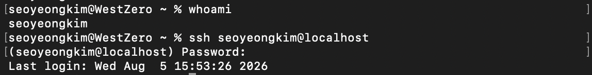
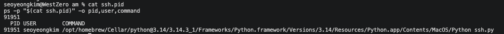
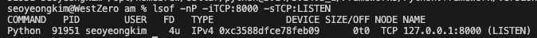
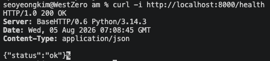
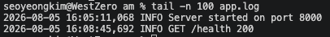
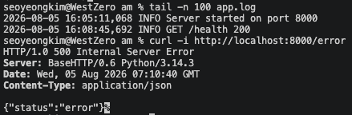
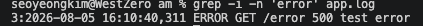
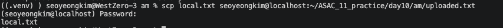

# SSH로 원격 Linux 서버에 접속 & 프로세스·Port·로그를 확인
## SSH 서버 켜기
MAC 이용시에는 내 MAC 자체를 SSH 서버처럼 사용가능 
```
내 Mac
├─ 로컬 터미널
│  └─ SSH Client
│
└─ macOS 원격 로그인
   └─ SSH Server
      └─ Python 애플리케이션
```


## ssh.py 구조
```
app.py
├─ 8000번 Port에서 실행
├─ /health
│  └─ HTTP 200 반환
├─ /error
│  └─ HTTP 500과 ERROR 로그 생성
└─ app.log
   └─ 요청 기록 저장
```
## ssh.py 실행
```
nohup python3 ssh.py > run.log 2>&1 &
echo $! > ssh.pid
```
구조
```
nohup python3 ssh.py > run.log 2>&1 &
│     │       │       │         │
│     │       │       │         └─ 백그라운드 실행
│     │       │       └─ 실행 오류와 출력을 run.log에 저장
│     │       └─ 실행할 Python 파일
│     └─ Python 3 실행
└─ 터미널이 종료되어도 프로세스 유지
```
```
echo $! > ssh.pid
│    │      │
│    │      └─ 프로세스 번호를 저장할 파일
│    └─ 방금 백그라운드에서 실행한 프로세스의 PID
└─ PID 출력
```
   
=> Python 서버의 PID가 91951임.
## Python 프로세스 확인
`cat ssh.pid`   
`ps -p "$(cat ssh.pid)" -o pid,user,command`   


## Port 확인
`lsof -nP -iTCP:8000 -sTCP:LISTEN`   


## Health API 호출
`curl -i http://localhost:8000/health`   
   
> HTTP 200 + {"status":"ok"} = 애플리케이션 정상 응답

## Log 확인
`tail -n 100 app.log`   
   
```
run.log
└─ Python 실행 실패, 문법 오류, Port 충돌 등

app.log
└─ 서버 시작, Health 요청, 오류 요청 기록
```

### 오류 Log 생성
`curl -i http://localhost:8000/error`   
   

### 오류 Log 검색
`grep -i -n 'error' app.log`   
   

## SCP 파일 전송
1. `exit` SSH 접속 종료
2. `scp local.txt <username>@localhost:~/ASAC_11_practice/day10/am/uploaded.txt` 로컬에서 파일 전송
```
scp local.txt <username>@localhost:~/ASAC_11_practice/day10/am/uploaded.txt
│   │         │            │         │
│   │         │            │         └─ 서버에서 저장할 경로와 이름
│   │         │            └─ 서버 주소
│   │         └─ 서버 사용자 계정
│   └─ 로컬에서 보낼 원본 파일
└─ SSH를 이용한 파일 전송 명령
```
   
3. 전송결과 확인
```
cd ~/ASAC_11_practice/day10/am
pwd
ls -l local.txt
cat local.txt
```